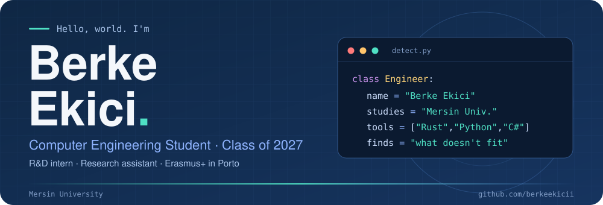

# Hi, I'm Berke Ekici

[LinkedIn](https://www.linkedin.com/in/berke-ekici-61a249347/)

I'm a Computer Engineering student at Mersin University in Turkey. I like building software that detects things: anomalies in network traffic, in physics data, and in images.

## What I work on

**Network security.** [dns-tunneling-detection](https://github.com/berkeekicii/dns-tunneling-detection) is an offline DNS tunneling detector written in Rust. It combines a threshold-based rule engine with an ONNX Isolation Forest model and writes NDJSON alerts.

**Machine learning.** [lhc-anomaly-detection](https://github.com/berkeekicii/lhc-anomaly-detection) is unsupervised anomaly detection on LHC collision events (ADC2021 challenge) with a small autoencoder. [capsule-detector-yolov8](https://github.com/berkeekicii/capsule-detector-yolov8) detects damaged and intact coffee capsules with YOLOv8 and a Streamlit app.

**Web.** I also build front-end pages and small desktop apps, for example [BTK-FrontEnd](https://github.com/berkeekicii/BTK-FrontEnd).

## Toolbox

Rust, Python, PyTorch, ONNX, YOLOv8, Streamlit, JavaScript, HTML/CSS, C#, Git

## Languages

Turkish (native) and English (advanced)

## Get in touch

The best way to reach me is [LinkedIn](https://www.linkedin.com/in/berke-ekici-61a249347/).
